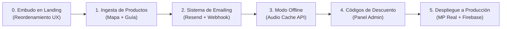

# 🚀 Plan de Implementación Técnica (Fase Post-Aprobación)
**Proyecto:** Psicología Verde Argentina / Psicólogo Vegano — Lic. Mauro García  
**Objetivo:** Guía operativa para ejecutar y desplegar en producción el ecosistema de tienda digital, automatización de emails, modo offline y carga de contenidos en cuanto Mauro apruebe el presupuesto.

---

## 📋 Resumen de Módulos a Ejecutar



---

## Módulo 0: Reestructuración y Embudo Terapéutico en Landing Page (`index.html`)

* **Objetivo:** Reflejar el embudo consensuado con Mauro (evitar un e-commerce frío genérico; dar protagonismo a los artículos con portadas y presentar la tienda como un paso terapéutico natural).
* **Estructura secuencial de la Landing:**
  1. **Hero Principal:** Posicionamiento claro (*Psicólogo Vegano — Espacio seguro*).
  2. **Reflexiones & Artículos (Suben de jerarquía):** Grid editorial con tarjetas visuales y portadas cuidadas para que el usuario conozca la perspectiva y profundidad del psicólogo antes de comprar.
  3. **Herramientas Terapéuticas (Tienda integrada):** Presentación elegante de los recursos digitales (*Mapa de Transiciones*, *Audioguías*, *Cuadernillos*) como el paso práctico para profundizar lo aprendido en los artículos. Botón directo de Checkout con Mercado Pago.
  4. **Servicios Clínicos (Atención 1 a 1 y Espacios Grupales):** Propuesta de acompañamiento para quienes buscan terapia personalizada o apoyo colectivo.
  5. **La Frontera / Comunidad:** Cierre con los encuentros vivenciales y retiros presenciales.

---

## Módulo 1: Procesamiento y Alta de los 2 Productos de Mauro

* **Origen:** Carpeta local `productos_raw/`
  * Producto A: *Mapa de Transiciones* (Audios + PDFs + Portada)
  * Producto B: *Segunda Guía Terapéutica* (Audios + PDFs + Portada)
* **Acciones técnicas:**
  1. Ejecución de script de carga por lotes (`scripts/seed_products.js`).
  2. Subida de portadas a `covers/` en Firebase Storage (públicas con cache control).
  3. Subida de archivos de trabajo a `private_assets/` (privados, protegidos por reglas de Storage).
  4. Creación de documentos multimodulares en la colección `products` de Firestore respetando el orden numérico secuencial de cada entregable.
  5. Verificación de permisos y pruebas de streaming temporal con Signed URLs.

---

## Módulo 2: Sistema Transaccional de Correos Electrónicos (Doble Notificación con Resend)

* **Proveedor:** [Resend](https://resend.com) (Capa gratuita de hasta 3.000 envíos mensuales con entrega garantizada en bandeja de entrada).
* **Estado actual:** No configurado aún en el repositorio; se instalará y testeará durante esta fase.
* **Integración en Backend (`functions/index.js`):**
  1. Incorporación de la librería oficial `resend` en `functions/package.json`.
  2. Configuración de `RESEND_API_KEY` en `functions/.env` y secrets de Firebase Functions.
  3. Modificación del webhook de Mercado Pago (`mercadopagoWebhook`) al detectar estado `approved`:
     * **Correo 1 (Al Comprador / Paciente):**
       - **Asunto:** `🌿 Acceso a tu recurso terapéutico: [Nombre del Producto] | Lic. Mauro García`
       - **Contenido:** Bienvenida personalizada, agradecimiento y mensaje firmado por Mauro.
       - **Detalle de la orden:** Número de pago, fecha, producto adquirido y monto abonado.
       - **Botón de acción:** Enlace directo para abrir su biblioteca privada en el portal (`https://psicologiaveganaarg.web.app/portal/`).
       - Instrucciones sobre cómo escuchar los audios (online/offline) y leer o descargar los cuadernillos PDF.
     * **Correo 2 (Alerta instantánea a Mauro a `verde.psicologia@gmail.com`):**
       - **Asunto:** `💰 ¡Nueva venta confirmada en la tienda! - [Nombre del Producto]`
       - **Contenido:** Notificación inmediata con los datos de la venta: Nombre y correo del comprador, importe cobrado en ARS, método de pago e ID de transacción de Mercado Pago.
* **Fase de Pruebas y Validación:**
  - Creación de un script de prueba (`scripts/test_email.js`) para verificar el despacho del correo tanto a una casilla de prueba como a Mauro antes de vincular el webhook en vivo.


---

## Módulo 3: Reproductor con Almacenamiento y Modo Offline

* **Tecnología:** `Cache Storage API` integrada en `portal-src/src/components/AudioPlayer.jsx`.
* **Características a incorporar:**
  1. **Botón de control "Disponible sin conexión":**
     * Indicador visual en el reproductor (ícono de nube / descarga local).
     * Estados: *Descargar para escuchar offline* / *Guardando en memoria...* / *Listo sin conexión (✓)*.
  2. **Persistencia en caché interna:**
     * Almacena el stream de audio en la memoria interna aislada del navegador (sin exponer el MP3 suelto en la carpeta de descargas del usuario).
  3. **Manejo de estados de red:**
     * Detección automática mediante `navigator.onLine`.
     * Si no hay señal de internet, el reproductor conmuta de forma transparente a la caché local.
     * Mantiene intactas las funciones de memoria de reproducción (minuto y segundo exacto), velocidad (1x, 1.5x) y rebobinado (+/-15s).
  4. **Compilación y empaquetado:** `npm run build` en `portal-src` para actualizar `/portal`.

---

## Módulo 4: Sistema de Códigos de Descuento (Gestión y Checkout)

* **Objetivo:** Permitir a Mauro generar códigos promocionales para sus pacientes y aplicarlos en el flujo de compra.
* **Componentes Técnicos:**
  1. **Panel de Administración (`/admin`):**
     * Ruta privada protegida mediante Firebase Auth (solo el UID de Mauro puede acceder).
     * Interfaz CRUD (Crear, Leer, Actualizar, Borrar) para gestionar los cupones.
     * Propiedades del código: Nombre (ej. `PACIENTE20`), Porcentaje/Monto de descuento, Límite de usos, Fecha de expiración.
  2. **Base de Datos (Firestore):**
     * Colección `discount_codes` para almacenar la configuración de cada cupón.
  3. **Checkout y Validación:**
     * Input de "Código de Descuento" en el flujo de compra antes de redirigir a Mercado Pago.
     * Backend (`functions/index.js`): Función que valide el código contra Firestore en tiempo real y aplique el descuento sobre el precio base antes de generar la preferencia de Mercado Pago.

---

## Módulo 5: Paso a Producción y Validación Final

1. **Credenciales Oficiales de Mercado Pago:**
   * Reemplazar las claves de prueba (Sandbox) por el `ACCESS_TOKEN` de producción provisto por Mauro.
   * Modificar `createCheckoutPreference` para activar el Checkout Pro real (`init_point`).
2. **Revisión de Seguridad y Reglas:**
   * Validar reglas de Firestore (`firestore.rules`) y Cloud Storage (`storage.rules`).
   * Confirmar que solo usuarios autorizados puedan generar Signed URLs y que solo Mauro tenga acceso a `/admin`.
3. **Despliegue a Firebase:**
   ```bash
   firebase deploy --only functions,hosting
   ```
4. **Prueba End-to-End (E2E):**
   * Realizar una compra real de prueba de bajo monto (con y sin código de descuento).
   * Verificar impacto en la cuenta de Mercado Pago de Mauro.
   * Comprobar acreditación inmediata en el `/portal`.
   * Verificar recepción del correo de bienvenida de Resend.

---

## 📌 Comando de Invocación
Cuando Mauro apruebe la propuesta y el presupuesto, simplemente enviá el siguiente mensaje para iniciar la ejecución:

> **"Mauro aprobó la propuesta. Ejecutá el Plan de Implementación Técnica Post-Aprobación."**
